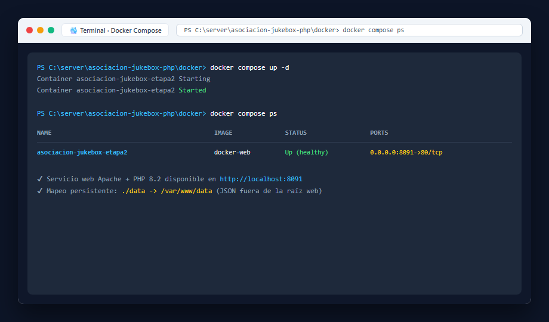
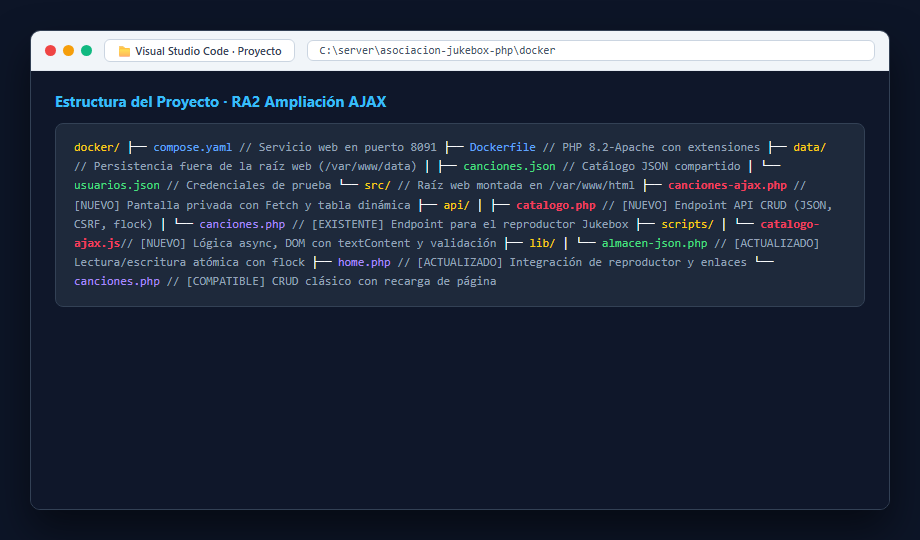

# Bloque 13: Preparación del Entorno y Nueva Estructura (RA2)

## 1. ¿Qué cambia y por qué?
Para cumplir con el encargo del cliente de gestionar el catálogo musical sin recargas de página completas, se inicia la segunda etapa del proyecto sobre el entorno Docker Compose existente en `docker/` (puerto `8091`), conservando intacta la etapa previa de RA1.

El objetivo de este bloque es preparar la infraestructura para alojar:
1. Una nueva pantalla privada (`canciones-ajax.php`) que alojará la interfaz interactiva.
2. Un nuevo endpoint API REST (`api/catalogo.php`) que responderá exclusivamente con JSON.
3. Un script en el cliente (`scripts/catalogo-ajax.js`) que coordinará las peticiones asíncronas mediante `fetch`.
4. El almacenamiento de datos en archivos privados JSON fuera de la raíz web (`/var/www/data`), accesible únicamente por el intérprete PHP y protegido de accesos HTTP directos desde el exterior.

## 2. Punto de Recuperación y Archivos Añadidos
Se ha establecido un punto de recuperación fechado de los archivos fuente antes de incorporar cualquier lógica AJAX. La estructura del directorio `docker/` queda organizada de la siguiente manera:

```text
docker/
  ├── compose.yaml              // Servicio web configurado en puerto 8091
  ├── Dockerfile                // Imagen PHP 8.2 con Apache
  ├── data/                     // Volumen montado en /var/www/data (almacén privado)
  │   ├── canciones.json        // Catálogo persistente
  │   └── usuarios.json         // Usuarios y credenciales ficticias
  └── src/                      // Raíz pública montada en /var/www/html
      ├── canciones-ajax.php    // [NUEVO] Pantalla con cliente asíncrono
      ├── api/
      │   ├── catalogo.php      // [NUEVO] API JSON para gestión CRUD
      │   └── canciones.php     // API para el reproductor Jukebox
      ├── scripts/
      │   └── catalogo-ajax.js  // [NUEVO] Lógica de interacción en el navegador
      ├── lib/
      │   ├── sesion.php        // Manejo de sesión y generación de token CSRF
      │   ├── acceso.php        // Control de autenticación
      │   └── almacen-json.php  // Transacciones seguras con flock
      ├── home.php              // Pantalla principal con reproductor Jukebox
      └── canciones.php         // CRUD clásico mantenido para comparación
```

## 3. Verificación de Servicios
Se ejecuta `docker compose up -d` y `docker compose ps` comprobando que el contenedor `asociacion-jukebox-etapa2` se encuentra activo y escuchando en el puerto local `8091`:

```powershell
docker compose up -d
docker compose ps
```





## 4. Resultado del Bloque
El entorno se encuentra levantado y operativo en `http://localhost:8091`. La home, el reproductor y el CRUD clásico funcionan de manera normal, listos para la incorporación progresiva de la arquitectura asíncrona.
