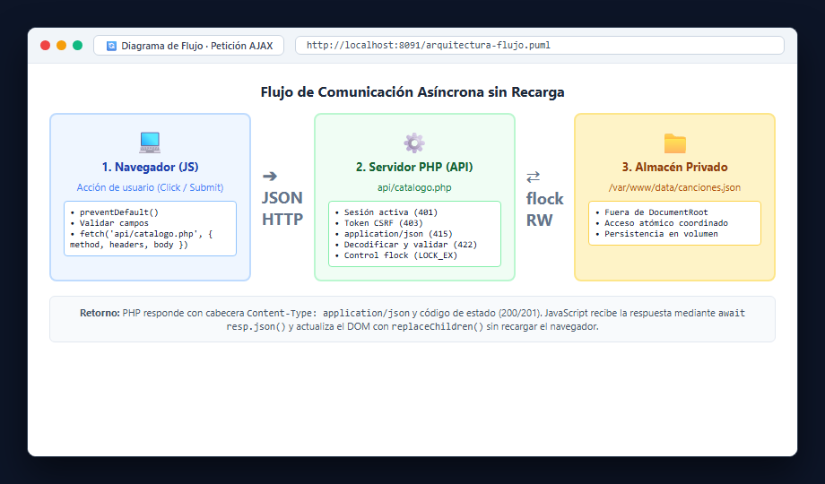
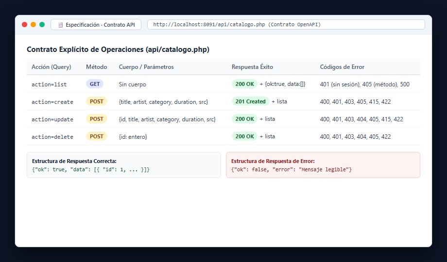

# Bloque 14: Entender la Nueva Petición y Acordar las Operaciones

## 1. ¿Qué cambia y por qué?
Hasta ahora, la interacción con la aplicación requería que cada envío de formulario provocase una navegación completa de tipo `Document`, recargando el navegador y perdiendo el estado visual.

Con **AJAX** (usando la API estándar `fetch` y formato **JSON**), el navegador delega en JavaScript el intercambio de datos en segundo plano:
1. **Acción del usuario:** El usuario pulsa un botón o envía un formulario.
2. **Intercepción con JavaScript:** Se cancela el comportamiento por defecto con `e.preventDefault()`, se leen y validan los valores en el cliente y se invoca `fetch('api/catalogo.php?...')`.
3. **Procesamiento en PHP:** El servidor web Apache y el intérprete PHP (ejecutándose en el contenedor) comprueban la sesión del usuario, el token anti-falsificación CSRF, el método HTTP, el tipo de medio y la validez de los datos.
4. **Acceso al Almacén:** Mediante un bloqueo de archivo exclusivo (`flock`), PHP lee, modifica y escribe atómicamente en `/var/www/data/canciones.json`.
5. **Respuesta JSON:** PHP serializa los datos con `json_encode()` y emite cabeceras HTTP limpias (`Content-Type: application/json; charset=utf-8`).
6. **Actualización del DOM:** JavaScript recibe el resultado, verifica el estado y actualiza únicamente los nodos necesarios de la tabla mediante `replaceChildren()` y `textContent`, sin recargar la página.



## 2. Dos Direcciones, Dos Responsabilidades
Ambas APIs leen y operan sobre el mismo almacén físico (`canciones.json`), pero sus contratos están separados por responsabilidad:
- **`api/canciones.php` (Reproductor Jukebox):** Devuelve una lista directa de objetos en formato array `[{ id, title, artist, duration, src }, ...]`. Este formato es consumido por el reproductor multimedia de `home.php` para cargar y escuchar los audios autorizados.
- **`api/catalogo.php` (Gestión del Catálogo):** Devuelve siempre un objeto envoltorio con la propiedad booleana `ok`. Si la operación tiene éxito, incluye la lista actualizada en `data`. Si ocurre algún fallo, devuelve `ok: false` y un mensaje descriptivo en `error`.

```json
// Respuesta de éxito (200 / 201)
{
  "ok": true,
  "data": [
    {
      "id": 1,
      "title": "Pre-race Music: 8Va Curves",
      "artist": "Yuto Takei",
      "category": "Breakbeat",
      "duration": 175,
      "src": "audio/8va_curves.mp3"
    }
  ]
}

// Respuesta de error (400, 401, 403, 404, 405, 415, 422, 500)
{
  "ok": false,
  "error": "Debes iniciar sesión."
}
```

## 3. Contrato Explícito de Operaciones
Para evitar inconsistencias entre cliente y servidor, se establece el siguiente contrato técnico:

| Acción | Método | Cuerpo JSON | Respuesta Exitosa | Errores Posibles |
| :--- | :---: | :--- | :--- | :--- |
| `?action=list` | **GET** | *(Vacío)* | **200 OK** + `{ok:true, data:[]}` | 401 (sin sesión), 405 (si no es GET), 500 |
| `?action=create` | **POST** | `{title, artist, category, duration, src}` | **201 Created** + `{ok:true, data:[]}` | 400, 401, 403, 405, 415, 422, 500 |
| `?action=update` | **POST** | `{id, title, artist, category, duration, src}` | **200 OK** + `{ok:true, data:[]}` | 400, 401, 403, 404, 405, 415, 422, 500 |
| `?action=delete` | **POST** | `{id}` | **200 OK** + `{ok:true, data:[]}` | 400, 401, 403, 404, 405, 422, 500 |

Todas las operaciones que mutan datos utilizan **POST**. El método **GET** queda estrictamente reservado a la consulta idempotente y jamás altera información.



## 4. Control de Acceso: ¿Por qué la API y la Página Privada difieren?
- **Página privada (`canciones-ajax.php`):** Está pensada para un usuario humano interactuando con su navegador. Si no existe sesión activa, la directiva `header('Location: login.php')` redirige al usuario a la pantalla de login para que introduzca sus credenciales.
- **Endpoint API (`api/catalogo.php`):** Está pensado para ser consumido por código (`fetch`). Si devolviese una redirección HTTP 302 con una página HTML de login, JavaScript interpretaría el código de login como el resultado esperado y, al ejecutar `response.json()`, fallaría catastróficamente con un error de sintaxis JSON (`SyntaxError: Unexpected token '<'`). Por ello, la API debe responder inequívocamente con el código de estado **`HTTP 401 Unauthorized`** y un cuerpo JSON `{ "ok": false, "error": "Debes iniciar sesión." }`.

## 5. Casos de Prueba del Contrato
1. **Consultar sin sesión iniciada:**
   - *Petición:* `GET api/catalogo.php?action=list` sin cookie de sesión.
   - *Código HTTP:* **`401 Unauthorized`**.
   - *Mensaje recibido:* `{"ok": false, "error": "Debes iniciar sesión."}`.
2. **Editar una ficha inexistente:**
   - *Petición:* `POST api/catalogo.php?action=update` enviando `{"id": 9999, ...}` con sesión y token válidos.
   - *Código HTTP:* **`404 Not Found`**.
   - *Mensaje recibido:* `{"ok": false, "error": "La canción no existe."}`.
3. **Enviar una duración negativa:**
   - *Petición:* `POST api/catalogo.php?action=create` con `"duration": -10`.
   - *Código HTTP:* **`422 Unprocessable Entity`**.
   - *Mensaje recibido:* `{"ok": false, "error": "La duración debe ser un entero entre 1 y 1800 segundos."}`.
