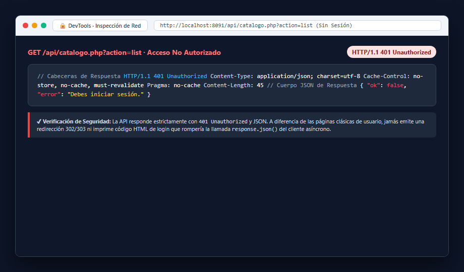
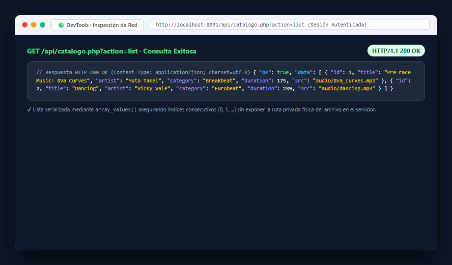
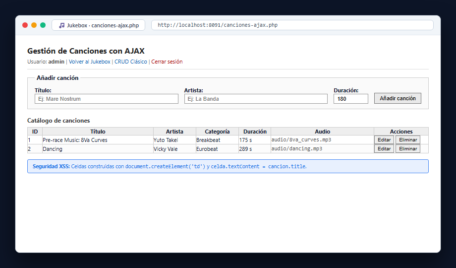

# Bloque 15: Consultar el Catálogo con Fetch y Construir una Tabla Fiable

## 1. ¿Qué cambia y por qué?
Se implementa el primer extremo del ciclo de vida del catálogo: la **lectura y consulta asíncrona**. Al acceder a `canciones-ajax.php`, la página HTML se descarga de inmediato y, sin esperar a un renderizado masivo en PHP, ejecuta el script `scripts/catalogo-ajax.js` (cargado con el atributo `defer` para garantizar que el DOM esté listo).

Este script solicita la lista de canciones mediante `fetch('api/catalogo.php?action=list')` y genera dinámicamente las filas de la tabla.

## 2. Implementación en el Servidor (`api/catalogo.php`)
1. **Control de Sesión:** Se comprueba `$_SESSION['login'] === true`. Si no existe sesión activa, se responde con código HTTP `401 Unauthorized` y el cuerpo JSON de error:
   ```php
   if (empty($_SESSION['login']) || $_SESSION['login'] !== true) {
       responderJson(401, ['ok' => false, 'error' => 'Debes iniciar sesión.']);
   }
   ```
2. **Método Restringido a GET:** Si la petición intenta consultar `action=list` con cualquier método distinto a GET (como POST), se rechaza con `405 Method Not Allowed` y la cabecera `Allow: GET`.
3. **Lectura con Bloqueo Compartido (`flock LOCK_SH`):** La función `leerCanciones()` en `lib/almacen-json.php` abre el archivo en modo lectura y adquiere un bloqueo compartido. Si el archivo está dañado o contiene JSON inválido, se lanza una excepción y la API responde con `HTTP 500 Internal Server Error`, impidiendo que un archivo corrupto sea sustituido silenciosamente por una lista vacía `[]`.
4. **Serialización Segura:** Se utiliza `array_values()` para asegurar que el array JSON tenga índices enteros consecutivos [0, 1, 2, ...], sin exponer claves asociativas internas.





## 3. Implementación en el Cliente (`scripts/catalogo-ajax.js`)

### A. Diferencia entre esperar la respuesta HTTP e interpretar su cuerpo JSON
En una función asíncrona (`async`), se ejecutan dos fases `await` distintas:
1. `const respuesta = await fetch('api/catalogo.php?action=list');`:
   Espera a que el servidor web establezca la conexión y envíe las cabeceras HTTP de respuesta (código de estado, tipo de contenido MIME, cookies). En este punto aún no se ha descargado ni analizado todo el contenido del cuerpo.
2. `const contenido = await respuesta.json();`:
   Espera la descarga completa del flujo de bytes del cuerpo de la petición y procesa la deserialización del texto JSON en objetos nativos de JavaScript. **El cuerpo solo puede consumirse una única vez.**

### B. ¿Por qué `respuesta.ok` no es lo mismo que `contenido.ok`?
- **`respuesta.ok`:** Es una propiedad nativa del objeto `Response` del navegador. Vale `true` únicamente si el código de estado HTTP recibido se encuentra en el rango de éxito (200 a 299). Es crucial notar que si el servidor responde con un 404 o un 500, `fetch` **no rechaza la promesa**, por lo que debemos verificar `respuesta.ok`.
- **`contenido.ok`:** Es un campo de nivel de aplicación definido en nuestro contrato. Si el servidor respondió con un 200 OK pero por alguna regla interna indica que la operación no fue exitosa, `contenido.ok` reflejará `false`. Ambos deben ser evaluados en conjunto:
  ```javascript
  if (!respuesta.ok || contenido.ok !== true) {
      throw new Error(contenido.error || 'No se pudo consultar el catálogo.');
  }
  ```

### C. Renderizado Seguro y Prevención de Inyecciones XSS
Para transformar la lista recibida en elementos HTML:
- Se vacía el contenedor utilizando `tbody.replaceChildren()`, una API moderna y atómica más eficiente y segura que manipular cadenas.
- Se recorre la colección y para cada propiedad se asigna mediante **`celda.textContent = cancion.title`**. A diferencia de `innerHTML`, `textContent` jamás interpreta etiquetas HTML; si un usuario malintencionado introduce `<script>alert(1)</script>` como título, se mostrará literalmente como texto plano sin ejecutarse.
- Si la colección está vacía (`canciones.length === 0`), se genera una fila con una única celda con `colSpan = 7` y el texto *"Todavía no hay canciones."*.
- Cada botón de acción almacena el identificador numérico de la canción en su atributo de datos: `btn.dataset.id = cancion.id`.



## 4. Resultado del Bloque
La lista de canciones se descarga e incrusta limpiamente en el documento sin interferir con la navegación del usuario y garantizando la máxima seguridad ante ataques de inyección XSS.
