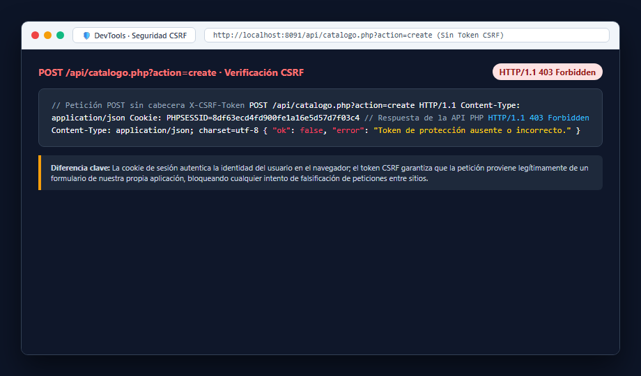
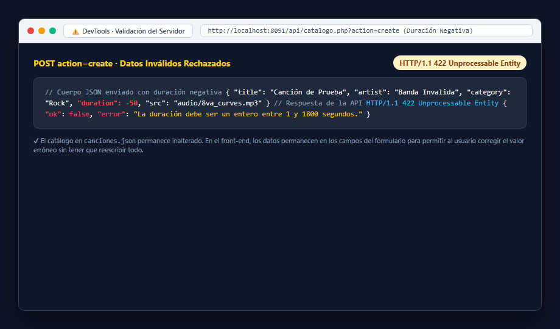
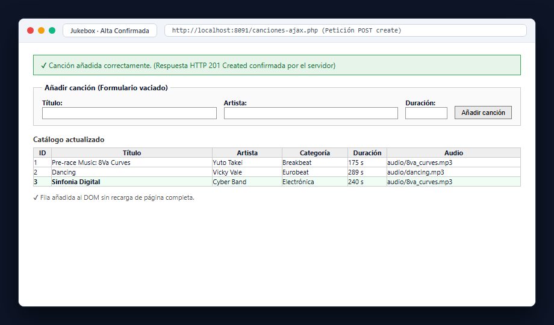

# Bloque 16: Preparar, Recibir, Validar y Enviar el Alta Segura

## 1. ¿Qué cambia y por qué?
El usuario puede incorporar nuevas pistas al catálogo desde la misma pantalla. Sin embargo, no se confía ciegamente en los datos enviados desde el navegador:
1. **El cliente facilita la entrada:** Validación nativa mediante atributos HTML5 (`required`, `maxlength="80"`, `min="1"`, `max="1800"`, `select` cerrados) y `reportValidity()`.
2. **El servidor decide:** PHP valida exhaustivamente los tipos de datos y las restricciones de negocio antes de realizar cualquier cambio en el almacenamiento en disco.

## 2. Protección contra Falsificación de Peticiones (CSRF)
Para asegurar que una petición POST provenga de un usuario legítimo que interactúa con nuestra interfaz y no de un sitio externo malicioso:
- En `canciones-ajax.php`, con la sesión iniciada, se publica el token en una etiqueta `<meta>` escapado para HTML:
  ```html
  <meta name="csrf-token" content="<?= htmlspecialchars($_SESSION['csrf'], ENT_QUOTES, 'UTF-8') ?>">
  ```
- JavaScript lee el token del DOM y lo envía en la cabecera personalizada **`X-CSRF-Token`** en cada petición POST:
  ```javascript
  headers: {
      'Content-Type': 'application/json',
      'X-CSRF-Token': csrfToken
  }
  ```
- En `api/catalogo.php`, PHP recupera el token desde `$_SERVER['HTTP_X_CSRF_TOKEN']` y lo compara de forma segura frente a ataques de temporización utilizando `hash_equals($_SESSION['csrf'], $tokenRecibido)`. Si falta o no coincide, devuelve **`HTTP 403 Forbidden`** inmediatamente.



> **Diferencia entre Sesión y Token CSRF:**
> - La **cookie de sesión** identifica al usuario autenticado y se envía automáticamente por el navegador en cada petición al mismo origen.
> - El **token CSRF** es un valor criptográfico secreto único asociado a la sesión actual que debe ser inyectado explícitamente en el cuerpo o cabecera de la petición por nuestro script. Protege al usuario frente a ataques en los que un sitio de terceros intente forzar una acción en nuestro servidor aprovechando la cookie de sesión automática.

## 3. Recepción y Validación del Cuerpo JSON en PHP
A diferencia de los formularios clásicos que envían datos codificados como `application/x-www-form-urlencoded` y se reciben en `$_POST`, las peticiones AJAX envían `application/json`.
- **Tipo de Medio (`Content-Type`):** Se verifica que comience por `application/json`. Si es diferente (por ejemplo, `text/plain`), se responde con **`HTTP 415 Unsupported Media Type`**.
- **Lectura del Flujo de Entrada:** PHP no rellena `$_POST` con JSON nativo; se debe leer el flujo en bruto desde `php://input`.
- **Decodificación Segura:** Se utiliza `json_decode($cuerpo, false, 512, JSON_THROW_ON_ERROR)`. Si el cuerpo está mal formado o incompleto, se captura `JsonException` y se responde con **`HTTP 400 Bad Request`**.
- **Validación de Tipos y Rangos:**
  * `title` y `artist`: deben ser cadenas (`is_string`), no vacías tras aplicar `trim()`, con longitud máxima de 80 caracteres.
  * `category`: debe pertenecer a la lista blanca autorizada (`CATEGORIAS_VALIDAS`).
  * `duration`: debe ser un entero estricto (`is_int`), entre 1 y 1800 segundos.
  * `src`: debe ser un archivo existente dentro de la lista de audios autorizados (`AUDIOS_VALIDOS`).
  Cualquier discrepancia genera una respuesta **`HTTP 422 Unprocessable Entity`** con un mensaje explicativo concreto.



## 4. Asignación del Identificador y Bloqueo Exclusivo
El identificador de la nueva canción **es asignado exclusivamente por el servidor PHP** calculando `max(id) + 1` (o 1 si el catálogo está vacío).
Esta operación se ejecuta dentro de una transacción protegida por **`flock(LOCK_EX)`** que abarca:
1. Adquisición del bloqueo exclusivo del archivo.
2. Lectura y deserialización del JSON existente.
3. Incorporación de la nueva canción.
4. Sobreescritura atómica en `/var/www/data/canciones.json`.
5. Liberación del bloqueo con `flock(LOCK_UN)`.

Tras persistir los cambios, la API responde con **`HTTP 201 Created`** y devuelve la lista completa actualizada.

## 5. Gestión del Envío e Interfaz
- **Protección contra Doble Envío:** Al pulsar enviar, una variable booleana `operacionEnCurso` deshabilita inmediatamente el botón de envío y los campos del formulario. Esto impide que un doble clic rápido genere dos peticiones concurrentes simultáneas al servidor. En el bloque `finally` se reactivan los controles.
- **¿Cuándo se vacía el formulario?:** El formulario se limpia mediante `formulario.reset()` **única y exclusivamente después de que el servidor confirme el éxito con HTTP 201**. Si la petición falla (código 422, 400, o error de red), los valores introducidos se conservan en pantalla para que el usuario pueda corregirlos sin perder su trabajo.


