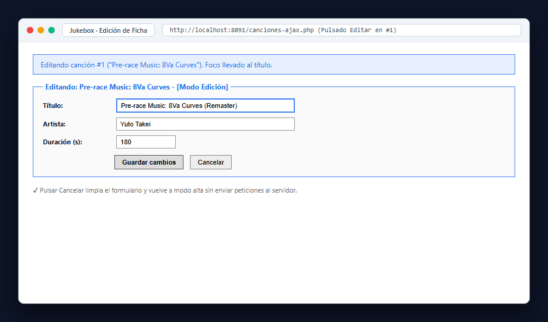

# Bloque 17: Editar la Canción Elegida Manteniendo su Identidad

## 1. ¿Qué cambia y por qué?
Para la modificación de canciones se reutiliza el mismo formulario de la pantalla, evitando la duplicidad de componentes. El reto fundamental es **preservar la identidad de la ficha**: la edición debe actualizar exactamente el registro seleccionado sin mutar su `id`, sin alterar otras canciones y sin duplicar la entrada.

## 2. Activación del Modo Edición en el Front-End
Al hacer clic en el botón *Editar* de una fila:
1. Se extrae el identificador desde el atributo de datos: `const id = Number(boton.dataset.id);`.
2. Se busca la canción en la copia en memoria de JavaScript utilizando su clave única:
   ```javascript
   const elegida = canciones.find(cancion => cancion.id === id);
   ```
   **Nota de diseño:** Nunca se busca por la posición en la tabla (índice de fila), ya que cualquier eliminación previa habría desplazado los índices.
3. Se rellenan los campos del formulario con los valores actuales (`title`, `artist`, `category`, `duration`, `src`).
4. Se guarda el `id` en el campo oculto `<input type="hidden" id="cancion-id">`.
5. Se adapta la interfaz:
   - El título del formulario cambia a: `Editando: [Título de la canción]`.
   - Se muestra un distintivo visual (*badge*) de modo edición.
   - El botón principal cambia su texto a: `Guardar cambios`.
   - Se hace visible el botón `Cancelar` (`type="button"`).
   - Se traslada automáticamente el foco al primer campo (`inputTitle.focus()`).



## 3. Envío y Validación en el Servidor (`action=update`)
Al enviar el formulario en modo edición, JavaScript despacha una petición `POST` hacia `api/catalogo.php?action=update` enviando un cuerpo JSON con el `id` y los 5 campos validados:

```json
{
  "id": 1,
  "title": "Pre-race Music: 8Va Curves (Remaster)",
  "artist": "Yuto Takei",
  "category": "Breakbeat",
  "duration": 180,
  "src": "audio/8va_curves.mp3"
}
```

En PHP:
1. Se validan las cabeceras (Sesión activa, Token CSRF, Content-Type `application/json`).
2. Se valida que `id` sea un entero positivo y que los 5 campos cumplan con las reglas de longitud, lista de categorías y audios autorizados.
3. Dentro de la transacción con bloqueo exclusivo (`flock LOCK_EX`), se busca la ficha con ese `id`.
4. **Si la canción no existe (por ejemplo, si otra pestaña la eliminó mientras el formulario estaba abierto), se responde con `HTTP 404 Not Found`**. La API jamás la vuelve a crear como una ficha nueva.
5. Si existe, se reemplazan sus propiedades conservando inalterado su `id` original y se escribe el archivo en disco.
6. La API devuelve **`HTTP 200 OK`** con el catálogo actualizado.

## 4. Diferencia entre Crear, Editar y Cancelar
- **Crear (`action=create`):** No envía `id`. PHP genera un identificador autonumérico mayor al existente. Responde con `201 Created` y la tabla añade una nueva fila.
- **Editar (`action=update`):** Envía el `id` obligatorio junto a los datos modificados. PHP localiza la ficha existente y la actualiza en su lugar sin generar nuevos IDs ni filas extra. Responde con `200 OK`.
- **Cancelar:** Es una acción estrictamente local en el navegador. Restablece el formulario (`formulario.reset()`), borra el campo oculto de `id`, oculta el botón *Cancelar* y devuelve el formulario al estado de alta sin realizar ninguna llamada de red ni alterar los datos guardados en el servidor.
