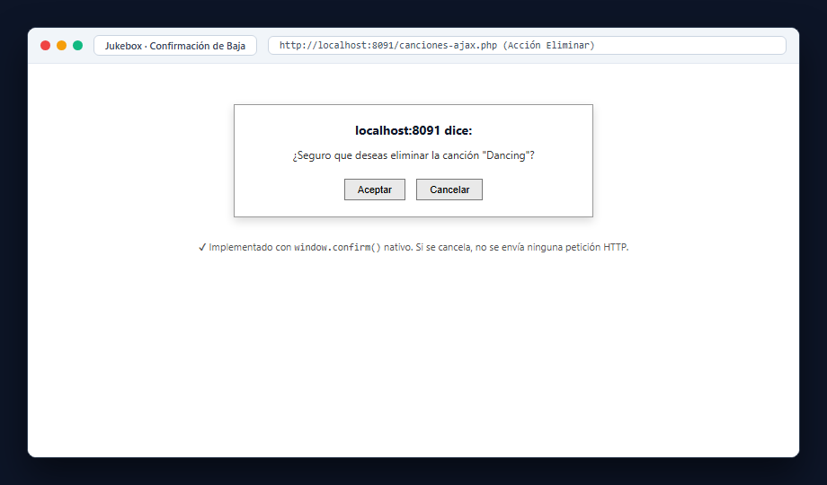
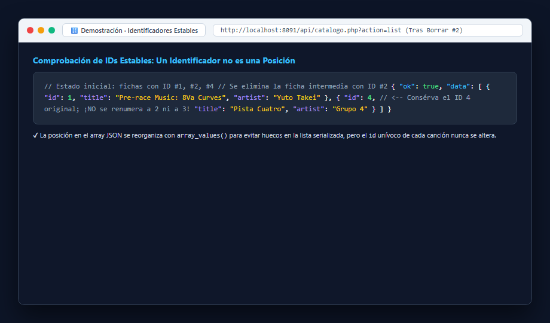

# Bloque 18: Eliminar sin Confundir Fichas y Mantener IDs Estables

## 1. ¿Qué cambia y por qué?
Se completa el ciclo CRUD con la operación de **eliminación** (`DELETE` lógico implementado mediante `POST ?action=delete`). Esta acción es crítica porque altera la colección existente; por ello, requiere confirmación explícita del usuario y un tratamiento estricto de los identificadores para evitar la corrupción de referencias.

> **Importante:** Eliminar una ficha del catálogo en `canciones.json` **no elimina el archivo de audio MP3 del disco**. La función `unlink()` no se invoca jamás sobre las canciones.

## 2. Diálogo de Confirmación en el Cliente
Al pulsar el botón *Eliminar* de una fila:
1. Se extrae el `id` y se recupera el título de la canción.
2. Se muestra un cuadro de confirmación nativo:
   ```javascript
   const confirmar = window.confirm(`¿Estás seguro de que deseas eliminar la canción "${nombre}"?`);
   if (!confirmar) {
       return; // Aborta inmediatamente sin enviar peticiones
   }
   ```
3. Si el usuario cancela, la interfaz permanece exactamente igual y no se despacha ningún tráfico de red.
4. Si confirma, se deshabilitan temporalmente los controles y se envía `POST api/catalogo.php?action=delete` con el cuerpo `{ "id": idNum }` y la cabecera `X-CSRF-Token`.



## 3. Lógica Atómica en PHP y Estabilidad de Identificadores
En `api/catalogo.php`:
1. Se valida que el `id` sea un entero positivo.
2. Dentro de la transacción con bloqueo exclusivo (`flock LOCK_EX`), se localiza la canción a eliminar.
3. Si el `id` no existe en el catálogo, se responde inmediatamente con **`HTTP 404 Not Found`** `{ "ok": false, "error": "La canción no existe." }`.
4. Si existe, se filtra la colección para extraer la ficha y se reindexa el array con `array_values()` para que la lista JSON resultante mantenga posiciones contiguas `[0, 1, 2, ...]`.
5. **No se renumeran los IDs restantes:** Si el catálogo contenía las fichas con ID `1`, `2` y `4`, tras eliminar la ficha `2`, la lista resultante conservará intactos los identificadores `1` y `4`. La ficha con ID `4` **no** se convierte en la ficha `2` ni en la `3`.
6. Se sobreescribe el archivo JSON y se responde con **`HTTP 200 OK`** junto a la lista resultante.



## 4. Reacción en la Interfaz de Usuario
Tras recibir la confirmación exitosa del servidor:
- Se vuelve a renderizar la tabla con `renderizarCanciones(respuesta.data)`.
- Si el usuario estaba editando justamente la canción que ha sido eliminada, la función invoca automáticamente `cancelarEdicion()` para limpiar el formulario y salir del modo edición.
- Si se han eliminado todas las canciones del catálogo, el renderizador detecta que `lista.length === 0` e inserta una fila con el mensaje accesible *"Todavía no hay canciones."* que abarca todas las columnas.
