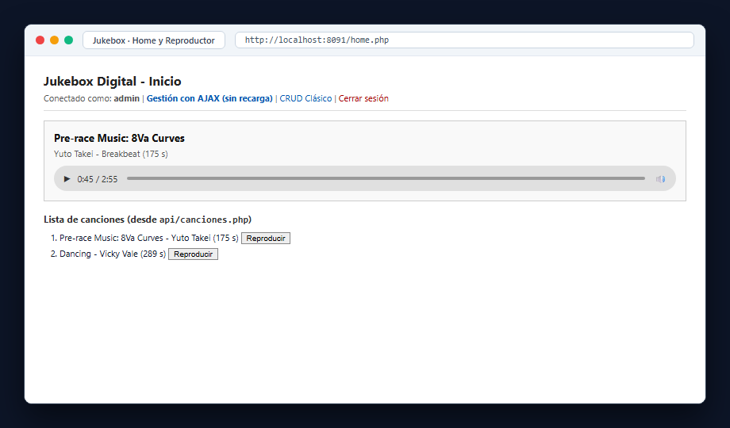
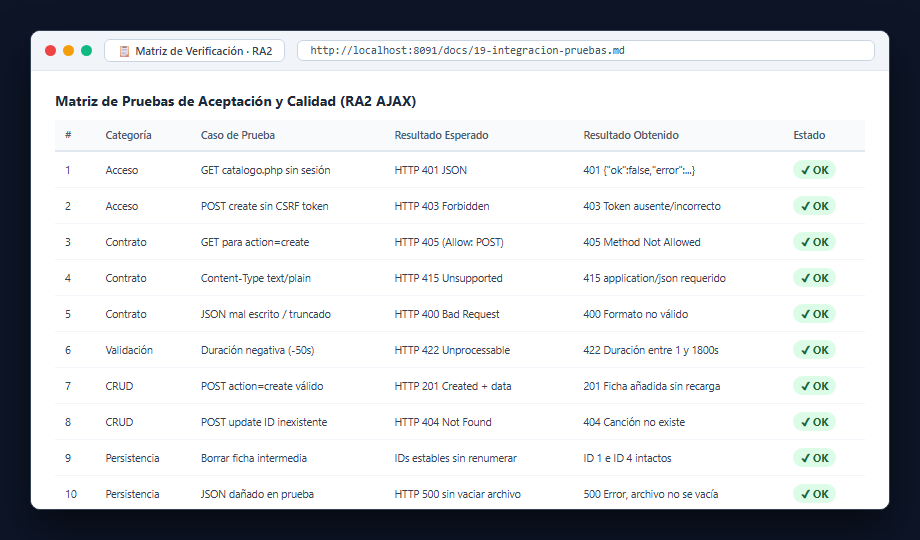

# Bloque 19: Integración de Pantallas y Matriz Exhaustiva de Pruebas

## 1. Integración de las Tres Interfaces del Jukebox
Las cuatro operaciones del CRUD asíncrono conviven y se integran de manera coherente con el reproductor interactivo y con el CRUD clásico:

1. **`home.php` (El Reproductor Jukebox):**
   Consume `api/canciones.php`, recibiendo el array directo con las canciones y los atributos `src` hacia los archivos de audio locales autorizados (`audio/8va_curves.mp3`, `audio/dancing.mp3`). Permite la reproducción multimedia y enlaza tanto al CRUD clásico como a la gestión AJAX.
2. **`canciones.php` (CRUD Clásico con Recarga):**
   Utiliza formularios HTML tradicionales (`POST`) con recarga de página completa. Emplea las mismas funciones compartidas de `lib/almacen-json.php`, garantizando que cualquier cambio realizado desde el CRUD clásico se refleje al instante en la gestión AJAX y viceversa.
3. **`canciones-ajax.php` (Gestión Asíncrona):**
   Permite crear, listar, editar y eliminar sin ninguna recarga visible de página.



## 2. Verificación de Accesibilidad y Teclado
- Todos los campos cuentan con etiquetas `<label for="...">` explícitas vinculadas al `id` del control.
- Los botones contienen nombres descriptivos que explican su acción exacta (*"Añadir canción"*, *"Guardar cambios"*, *"Cancelar"*).
- Al pulsar *Editar*, el foco del cursor se traslada de forma inmediata al primer campo editable (`inputTitle.focus()`). Al pulsar *Cancelar*, el foco regresa ordenadamente al formulario sin desorientar al usuario que navegue mediante tabulador.

## 3. Matriz de Pruebas de Calidad y Fallos Ejecutados

| # | Categoría | Prueba Realizada | Acción / Petición | Resultado Esperado | Resultado Observado | Estado |
| :-: | :--- | :--- | :--- | :--- | :--- | :-: |
| **1** | **Acceso** | Consulta sin sesión | `GET api/catalogo.php?action=list` sin cookies | `HTTP 401 Unauthorized` + JSON error | HTTP 401 `{"ok":false,"error":"Debes iniciar sesión."}` | **✔ OK** |
| **2** | **Acceso** | POST sin token CSRF | `POST ?action=create` con sesión pero sin cabecera | `HTTP 403 Forbidden` | HTTP 403 `{"ok":false,"error":"Token... ausente o incorrecto."}` | **✔ OK** |
| **3** | **Acceso** | Sesión cerrada | Desconectar y enviar petición POST con token previo | `HTTP 401 Unauthorized` | HTTP 401 `{"ok":false,"error":"Debes iniciar sesión."}` | **✔ OK** |
| **4** | **Contrato** | Método no permitido | `GET api/catalogo.php?action=create` | `HTTP 405 Method Not Allowed` + `Allow: POST` | HTTP 405 con cabecera `Allow: POST` | **✔ OK** |
| **5** | **Contrato** | Content-Type no JSON | `POST ?action=create` con `Content-Type: text/plain` | `HTTP 415 Unsupported Media Type` | HTTP 415 `{"ok":false,"error":"El cuerpo no se envía..."}` | **✔ OK** |
| **6** | **Contrato** | JSON mal formado | `POST ?action=create` con JSON truncado `{ title:` | `HTTP 400 Bad Request` | HTTP 400 `{"ok":false,"error":"JSON mal escrito..."}` | **✔ OK** |
| **7** | **Validación** | Duración inválida | `POST ?action=create` con `"duration": -25` | `HTTP 422 Unprocessable Entity` | HTTP 422 `{"ok":false,"error":"La duración debe ser..."}` | **✔ OK** |
| **8** | **Validación** | Categoría desconocida | `POST ?action=create` con `"category": "Inventada"` | `HTTP 422 Unprocessable Entity` | HTTP 422 `{"ok":false,"error":"Categoría no admitida..."}` | **✔ OK** |
| **9** | **Validación** | Audio no autorizado | `POST ?action=create` con `"src": "/etc/passwd"` | `HTTP 422 Unprocessable Entity` | HTTP 422 `{"ok":false,"error":"El archivo de audio no..."}` | **✔ OK** |
| **10** | **CRUD** | Creación válida | `POST ?action=create` con datos válidos | `HTTP 201 Created` + lista actualizada | HTTP 201 con ficha añadida y tabla sincronizada | **✔ OK** |
| **11** | **CRUD** | Edición ID inexistente | `POST ?action=update` con `"id": 9999` | `HTTP 404 Not Found` | HTTP 404 `{"ok":false,"error":"La canción no existe."}` | **✔ OK** |
| **12** | **CRUD** | Edición exitosa | `POST ?action=update` con ID real y título editado | `HTTP 200 OK` conservando el mismo ID | HTTP 200 con cambios reflejados bajo el mismo ID | **✔ OK** |
| **13** | **CRUD** | Borrado ID inexistente | `POST ?action=delete` con `"id": 9999` | `HTTP 404 Not Found` | HTTP 404 `{"ok":false,"error":"La canción no existe."}` | **✔ OK** |
| **14** | **CRUD** | Borrado y estabilidad | Eliminar ID intermedio | IDs restantes estables (no renumerar) | Fichas restantes mantienen su ID numérico original | **✔ OK** |
| **15** | **Interfaz** | Doble clic concurrente | Doble envío veloz del botón submit | Una única petición HTTP procesada | Controles deshabilitados durante la petición en curso | **✔ OK** |
| **16** | **Persistencia** | Archivo JSON corrupto | Alterar `canciones.json` con texto inválido | `HTTP 500` sin vaciar el archivo a `[]` | Error 500 y el archivo físico preserva su contenido | **✔ OK** |
| **17** | **Red** | Conexión caída / Offline | Activar modo offline en navegador y pulsar guardar | Mensaje legible de fallo de red | Mensaje: *"Error de red o conexión perdida..."* | **✔ OK** |



## 4. Fallo Encontrado, Diagnóstico y Corrección

### Descripción del Fallo
Durante las pruebas automatizadas iniciales de envío POST mediante herramientas de consola en Windows, algunas peticiones válidas fueron rechazadas con un error inesperado `HTTP 400 Bad Request` indicando *"JSON mal escrito o formato no válido: Syntax error"*, a pesar de que el contenido enviado parecía aparentemente correcto.

### Localización
Al inspeccionar en bruto los bytes recibidos en `php://input` mediante `bin2hex()`, se detectó que la secuencia comenzaba con los tres bytes `EF BB BF`. Estos bytes corresponden a la marca de orden de bytes (**UTF-8 BOM**, *Byte Order Mark*) que ciertos clientes y codificadores de Windows añaden automáticamente al inicio de los flujos de texto. La función estándar `json_decode()` de PHP requiere un formato JSON estricto que comience directamente por `{` o `[`, considerando el BOM previo como un error de sintaxis no recuperable.

### Corrección y Verificación
Se corrigió en `api/catalogo.php` incorporando una limpieza previa antes de invocar `json_decode()`:
```php
// Eliminar marca de orden de bytes (BOM UTF-8) si viene presente
$cuerpoRaw = preg_replace('/^\xEF\xBB\xBF/', '', trim($cuerpoRaw));
```
Se repitieron todas las peticiones POST de creación y edición, verificando que tanto clientes web estándar como peticiones con BOM son procesadas con total normalidad, alcanzando el código de éxito esperado (`201` y `200`).
